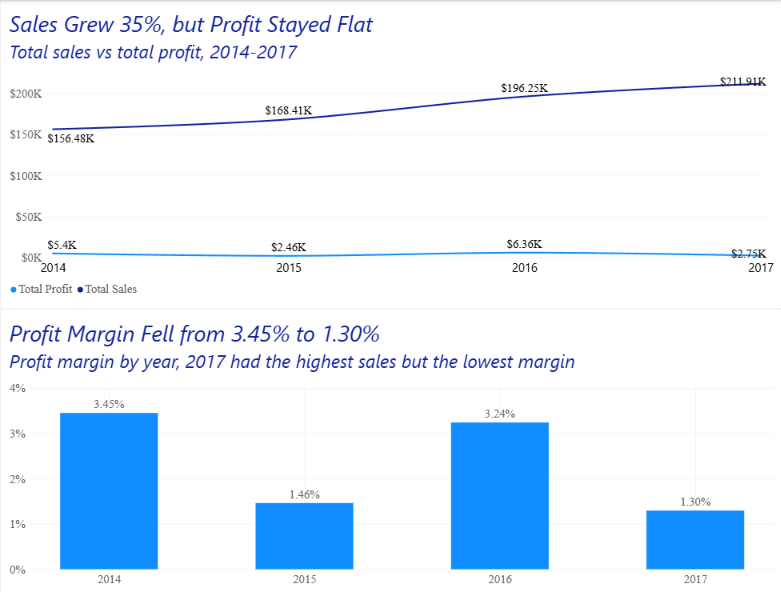
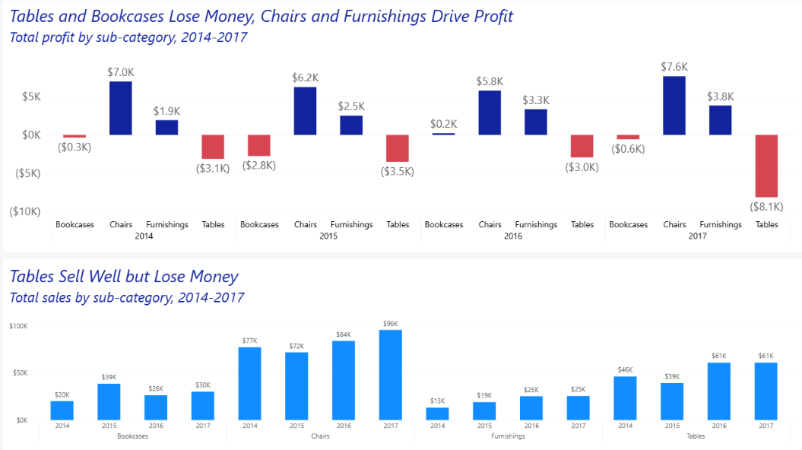
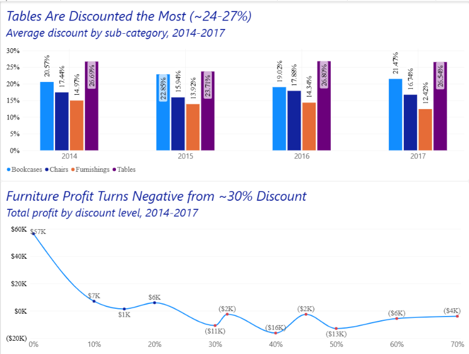
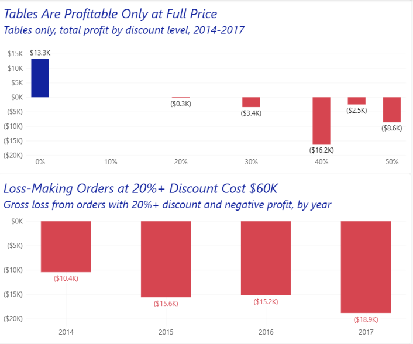
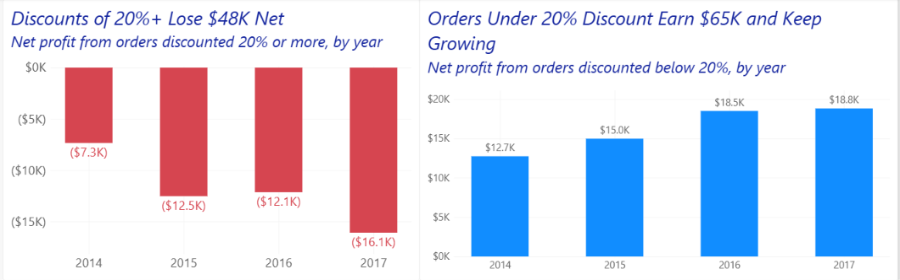

# Where Is the Profit Leaking? Discount Analysis of a US Furniture Retailer

> Sales grew 35% from 2014 to 2017, but profit stayed flat. Discounts of 20%+ lost about $48K.

**Tools:** Power BI, DAX

---

## Business Question

Why did profit stay flat while sales grew 35%, and where is the money being lost?

I analyzed four years of furniture sales data (2014-2017) as if reviewing a business before investing, focusing on profit quality: which products and which discount levels create or destroy profit.

## Key Findings

**1. Sales grew, profit did not.**
Sales rose from $156K to $212K (+35%), but profit stayed between $2.5K and $6.4K a year. Profit margin fell from 3.45% (2014) to 1.30% (2017). 2017 had the highest sales and the lowest margin.



**2. Average discount does not explain the swings, but products do.**
Average discount by year was stable, so yearly profit swings are not explained by discount level alone. Tables are discounted the most (about 24-27%) and lost money every year, with the loss more than doubling in 2017 (-$3.0K to -$8.1K). Bookcases drove the 2015 dip (-$2.8K). Chairs and Furnishings are the profit engines.



**3. Deep discounts turn orders unprofitable.**
Furniture earns about $57K at 0% discount, but profit shrinks as discounts increase and turns negative from about 30%. Tables are profitable only at full price (+$13.3K at 0%) and lose money from a 20% discount upward, with the worst level at 40% (-$16.2K).



**4. Discounts of 20%+ erase most of the healthy profit.**

| Group | Net profit, 2014-2017 |
|---|---|
| Orders discounted below 20% | about +$65K |
| Orders discounted 20% or more | about -$48K |
| **Total furniture profit** | **about +$17K** |

- Loss-making orders at 20%+ discount totaled about $60K in gross losses.
- In 2017, discount losses erased about 86% of the profit earned from healthier orders, leaving only $2.7K.




## Recommendation

**Cap discounts at 20% for Furniture, with a stricter cap for Tables.**

If orders at 20%+ discount had broken even instead of losing money, profit over 2014-2017 would have been up to about $48K higher, nearly three times the actual $17K. This is an upper bound, not a forecast, because customers may buy less when discounts are limited.

## Data and Limitations

- Source: public Superstore sample dataset, Furniture category only, 2014-2017.
- "Profit" is the profit value in the dataset. There is no cost breakdown, cash flow, debt, or returns data, so this is an analysis of sales and discount quality, not a full investment valuation.
- Results are descriptive and based on past data. Discount is strongly associated with losses, but the data cannot prove it is the only cause.
- Possible next steps: analysis by State/Region and customer segment.

## Key DAX Measures

```dax
Total Profit = SUM('furniture furniture'[Profit])

Profit Margin % = DIVIDE([Total Profit], [Total Sales])

Profit at Discount 20%+ =
CALCULATE(SUM('furniture furniture'[Profit]), 'furniture furniture'[Discount] >= 0.2)

Profit below Discount 20% =
CALCULATE(SUM('furniture furniture'[Profit]), 'furniture furniture'[Discount] < 0.2)
```

## About Me

Khom Thona |  Data Analyst
khomthona5@gamil.com
